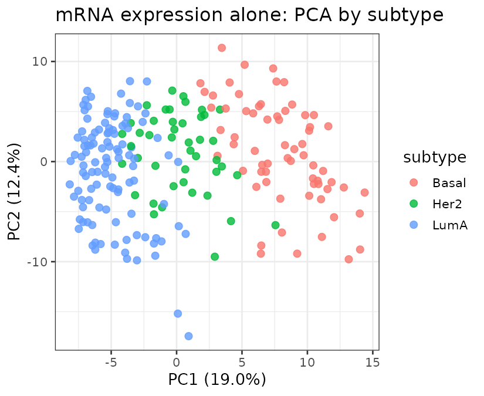
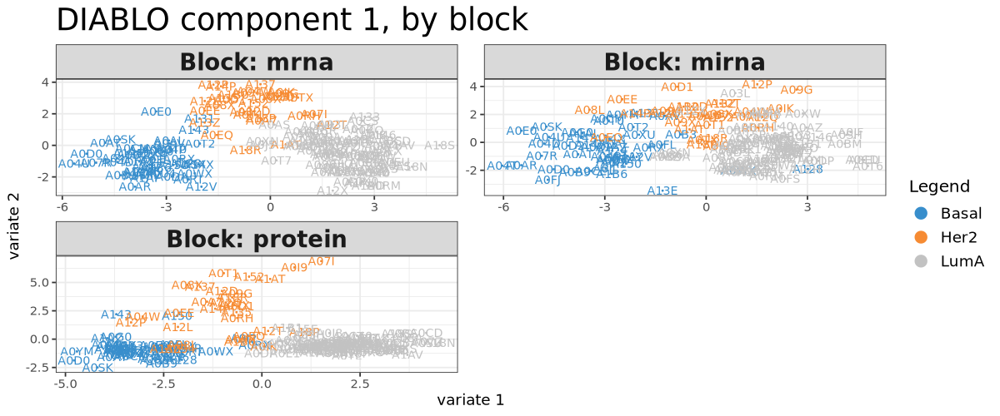

# Multi-Omics Integration Capstone (DIABLO)

A supervised multi-omics integration analysis on real, matched TCGA breast cancer data: mRNA expression, miRNA expression, and RPPA protein data measured on the same patients, integrated with DIABLO to predict molecular subtype, and benchmarked against what each omics layer achieves alone.

> **Key result:** mRNA expression alone already reaches 98.6% held-out test accuracy; the 3-block DIABLO integration reaches 94.3% using a sparse 45-feature signature (15 per block) while predicting on test samples that are missing the protein block entirely. Integration here does not beat the strongest single block, and that is reported honestly below, not hidden.

## Technologies used

R, mixOmics (DIABLO, sPLS-DA, PCA), ggplot2. Data exports prepared for a Power BI dashboard (not yet built; see "Power BI dashboard" below).

## Biological background

Breast cancer is not one disease: PAM50 molecular subtypes (Basal, Her2-enriched, Luminal A, and others) have different biology, prognosis, and treatment response, and are defined using gene expression, not histology alone. A real question in the field is whether combining multiple molecular layers (transcriptomics, microRNA, proteomics) distinguishes subtypes better than any one layer alone, and if so, which features in each layer are actually doing the discriminating. That is a genuine multi-omics integration question, not just three separate analyses run side by side, which is why this project uses a method (DIABLO) specifically designed to model shared structure across blocks measured on the same samples.

## Dataset

This is real TCGA (The Cancer Genome Atlas) breast cancer data, not simulated: the `breast.TCGA` dataset distributed with the mixOmics package (used in Singh et al. 2019, the DIABLO methods paper, and in the official mixOmics case studies).

| Property | Value |
|---|---|
| **Source** | `mixOmics::breast.TCGA`, ships with the package, no external download |
| **Samples** | 150 training, 70 test, all three omics layers measured on the same patients within the training set |
| **mRNA block** | 200 pre-filtered expression features |
| **miRNA block** | 184 features |
| **Protein block (RPPA)** | 142 features, **training set only** |
| **Target** | Molecular subtype: Basal (45 train / 21 test), Her2 (30 / 14), LumA (75 / 35) |

**An honest, real wrinkle, not a bug in this analysis:** the protein (RPPA) block does not exist at all in the test set. That is a genuine property of this dataset (RPPA profiling was not run on those samples), and it is also the actual scenario DIABLO is designed to handle: predicting subtype for a sample using whichever blocks are actually available for it, not assuming every sample has every layer. This project treats that gap as the real test case it is, rather than dropping the protein block or discarding the affected samples.

## Workflow

1. Load the three training blocks and confirm their sample IDs are identical across blocks (`01_explore_data.R`)
2. Baseline: PCA on each block alone (visualization) and a PLS-DA classifier per block, cross-validated (5-fold, 10 repeats) on the training set and evaluated on the held-out test set where that block exists (`02_single_omics_baseline.R`)
3. Fit a sparse DIABLO model (`block.splsda`, 2 components, `keepX = 15` per component per block, a fully connected design with correlation weight 0.1 between every pair of blocks), cross-validate the same way, and predict on the test set using whichever blocks are available per sample (`03_diablo_integration.R`)
4. Export tidy tables for a Power BI dashboard (see below)

## How to run it

```bash
mamba env create -f environment.yml
conda activate multi-omics-integration-capstone

Rscript scripts/01_explore_data.R
Rscript scripts/02_single_omics_baseline.R
Rscript scripts/03_diablo_integration.R
```

No external data download: `breast.TCGA` ships inside the mixOmics package itself. Expected runtime: under 2 minutes total on a 7 GB RAM machine; the slowest step is the repeated cross-validation in `perf()`, a few thousand model refits on a dataset this small.

## Results and interpretation

**Single block baselines.** mRNA expression alone is already a strong classifier (5-fold CV balanced error rate 0.046, held-out test accuracy 98.6%). miRNA alone is noticeably weaker (CV BER 0.194, test accuracy 84.3%). Protein alone has a CV BER of 0.145 but no test accuracy to report, since the test set has no protein data at all.



Even unsupervised PCA on mRNA alone, with no label information used to build the axes, visually separates the three subtypes along PC1. That is a hint, confirmed by the PLS-DA baseline above, that this particular omics layer is unusually strong for this particular task.

**DIABLO integration (sparse, 45 features total).** The 3-block sparse DIABLO model reaches a CV balanced error rate of 0.119 and a held-out test accuracy of 94.3%, predicting with only the mRNA and miRNA blocks for every test sample (the protein block is simply absent, and DIABLO's `predict()` handles that by using the blocks that are actually present).

| Model | Blocks used | CV balanced error rate | Test accuracy |
|---|---|---|---|
| mRNA expression alone | 1 | 0.046 | 98.6% |
| miRNA expression alone | 1 | 0.194 | 84.3% |
| Protein (RPPA) alone | 1 | 0.145 | n/a (no test data) |
| **DIABLO, all 3 blocks integrated** | 3 | 0.119 | **94.3%** |

**The honest headline: integration did not beat the single best block here.** mRNA alone outperforms the 3-block integrated model on this dataset's test set (98.6% vs 94.3%). That is a real, correctly measured result, and it is worth taking at face value rather than reframing it as a win: when one omics layer is already a near-ceiling predictor on its own, adding noisier layers (miRNA's own standalone accuracy is only 84.3%) to a joint model can pull the fused prediction down slightly relative to that one strong layer. What DIABLO's integration does demonstrably provide here is robustness to a missing block: the fused model still reaches 94.3% test accuracy using only 2 of its 3 trained blocks, comfortably ahead of miRNA's own 84.3% standalone accuracy, on exactly the samples where protein data was never collected. That is the realistic value multi-omics integration offers on this dataset: not a guaranteed accuracy win over the best single layer, but a model that degrades gracefully instead of failing outright when a real-world sample is missing one of its measured layers.



**Confusion matrix (test set, DIABLO integrated model).** Of 70 test samples, 66 were classified correctly; all 4 errors were between Basal and Her2 or Her2 and LumA, never between Basal and LumA, the two subtypes furthest apart biologically (full table in `results/tables/diablo_test_confusion_matrix.csv`).

**The 45-feature sparse signature is biologically recognizable, not arbitrary.** The protein block's top selected features include ER-alpha, PR (progesterone receptor), GATA3, and AR (androgen receptor): all established, textbook breast cancer subtype markers, not features a model invented. The mRNA block's top features include CCNA2 and E2F1 (cell cycle regulators) and ASPM (a proliferation marker), consistent with Basal/proliferative subtypes being biologically distinct from Luminal A. Full ranked list in `results/tables/diablo_top_features_comp1.csv`.

## Power BI dashboard

**Not yet built.** Power BI Desktop is a GUI application, so building the dashboard itself is a manual step for Mohamed, not something run from this repo. What this project does provide is five clean, already-joined CSV exports (`results/tables/model_performance_summary.csv`, `pca_coordinates_by_block.csv`, `diablo_top_features_comp1.csv`, `diablo_test_confusion_matrix.csv`, `sample_metadata.csv`) plus `docs/power_bi_notes.md`, which maps each table to a recommended visual. Until the dashboard exists, this project should not be described as including one.

## Limitations

- **Integration did not beat the single best block on this dataset**, as reported above; that is a property of this specific dataset (mRNA happens to be unusually strong alone here), not a general claim that multi-omics integration never helps
- **The DIABLO design matrix (0.1 between every block pair) and `keepX` (15 per component) were fixed, reasonable defaults, not tuned** via `tune.block.splsda`'s grid search, which is computationally heavier than this scoped analysis aimed for
- **No external validation cohort.** All 220 samples come from the same TCGA release
- **The missing protein test block limits what can be claimed.** There is no way to know, from this dataset alone, whether protein data would have helped or hurt on those specific 70 test samples had it been collected
- **Only 2 components were fit.** More components might change which features are selected and the exact CV balanced error rate, at the cost of a harder to interpret model

## Future improvements

- Run `tune.block.splsda` to formally select `keepX` per block/component instead of the fixed value of 15 used here
- Try a design matrix with a stronger between-block correlation weight (for example 1 instead of 0.1) and compare CV performance
- Add a fourth omics layer if one becomes available for the same samples (for example copy number or methylation), to test whether a 4-block model changes the integration-vs-single-block conclusion
- Build the actual Power BI dashboard from the five exported tables (see "Power BI dashboard" above)
- Revisit with a dataset where no single block is already a near-ceiling predictor, to see whether integration's advantage is clearer when the single-block baselines are more evenly matched

## Contact / links

GitHub: [MohamedElsaid-bit](https://github.com/MohamedElsaid-bit)
Portfolio: [mohamedelsaid-bit.github.io/Portfolio-](https://mohamedelsaid-bit.github.io/Portfolio-/)
